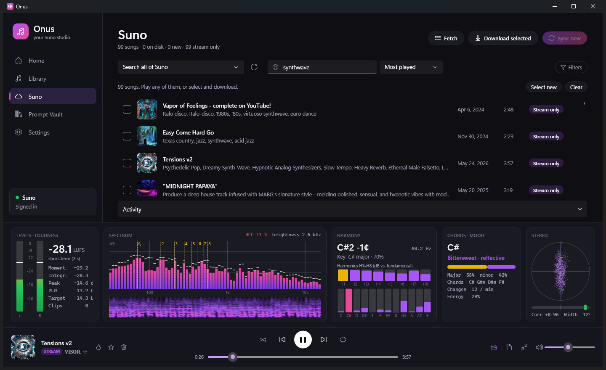
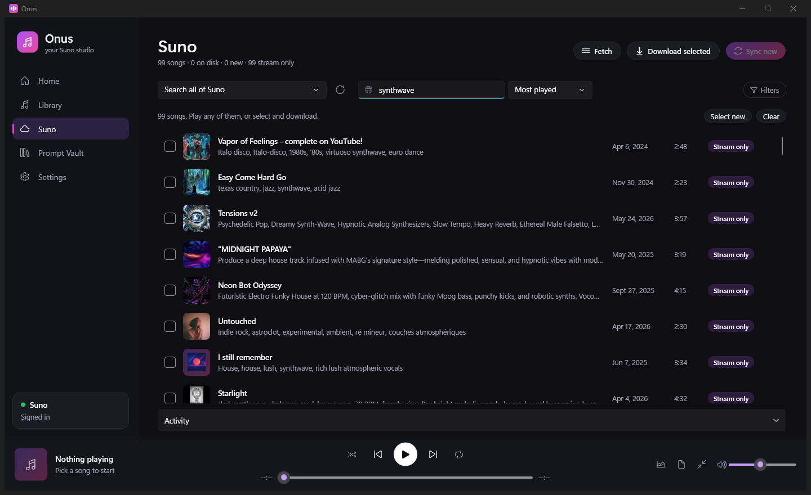

# Onus

A native Windows app for your Suno library: browse it, download it, listen to it, and look inside the sound while it
plays. It's a rework of [SunoSync](https://github.com/sunsetsacoustic/SunoSync) with a player that works.



## Features

### Sign in once
- Sign in through a built-in Edge (WebView2) window. Onus refreshes Suno's short-lived session (~60 s tokens) on
  its own, so you don't need a browser extension or to copy tokens.
- If the window refuses your login method, paste the `__client` cookie from your normal browser
  (Settings → *Trouble signing in?*). A manual bearer token is available as a last resort.

### Suno page


- Browse **My Library**, any workspace or any playlist.
- **Search all of Suno:** pick *Search all of Suno* as the source, type a term (or leave it empty to browse every
  public song) and sort by most relevant, newest, most played or most liked. Each Fetch lists 100 songs; stream any
  of them, or download the ones Suno offers a file for. *Sync new* is off here.
- **Fetch** lists everything, and every row shows its status: *New*, *On disk*, *Stream only* or *Analytics cache*.
  **Stream any song right away**; if it's already on disk, the local file plays instead.
- **Download selected**, or **Sync new** to download everything that isn't on disk yet. Downloads run in parallel
  with a polite delay between files. **Smart Resume** stops after a run of pages with nothing new instead of
  walking your whole history.
- Filters: liked only, hide disliked, hide or show only stems, hide studio clips, public only, include trash, type
  (generations / uploads), styles to include or exclude, and a text search over title, style and lyrics.
- An activity log shows what each download did and why one failed (for example `Failed · 403`, with the reason in
  the tooltip).
- **Stream-only songs.** Accounts without unlocked downloads don't get an audio file from Suno for some songs.
  Onus plays those through suno.com's own player in a hidden browser view, so you can still listen in the app.
  They can't be downloaded.

### Downloads
- MP3, or WAV (Suno renders it first and Onus falls back to MP3 if that fails).
- Tags: title, artist, style, year, comment, lyrics, prompt, cover art and the Suno id (`TXXX:SUNO_UUID`, the same
  tag SunoSync writes, so existing SunoSync folders are recognised and never downloaded twice).
- Optional `.txt` lyrics and `.jpg` / `cover.jpg` files next to each song, month folders, separate folders for
  workspace and playlist downloads, and stems grouped in a folder named after their song.
- Every file is written to a `.part` file, checked, then moved, so an interrupted download never looks finished.

### Library
- Every song in your folder with cover art, style, BPM and length. Search, sort, and filter by keep / star / trash
  marks.
- Edit tags, copy the file (Ctrl+C) to paste into a DAW, show it in Explorer, save its prompt to the Vault, or
  move it to the Recycle Bin (Del).
- Play all or shuffle.

### Player
- Windows' own audio engine, so there's nothing to install. It hooks into media keys and the Windows media flyout.
- Shuffle and repeat (off / all / one), keep / star / trash from the player bar, a now-playing panel with lyrics,
  and an always-on-top mini player.

### Live analysis
Press **A** or the chart button on the player bar. The panel works for local files, normal streams and stream-only
songs alike. It captures only Onus's own audio, never other apps.

- **Levels and loudness:** left/right meters with peak hold. Loudness per ITU-R BS.1770 in LUFS: momentary
  (400 ms), short-term (3 s) and integrated for the whole song. Also max peak, PLR (peak to loudness ratio), the
  offset from the −14 LUFS most streaming services normalise to, and a clip counter.
- **Spectrum:** a 72-band log-frequency spectrum with peak caps, dashed markers on the harmonics of the detected
  note, a scrolling spectrogram, and brightness (spectral centroid).
- **Harmony:** dominant pitch with its offset in cents, the strength of harmonics H1–H8 relative to the
  fundamental, energy per note (chroma), and a key estimate built from about 8 seconds of listening.
- **Stereo:** goniometer, left/right correlation (red when the channels are out of phase) and stereo width.

Readings describe the song itself: Onus divides its own volume slider (and the volume Suno's page applies) back
out.

### Analytics cache (stream-only songs)
When a stream-only song plays from 0:00 to the end without seeking, Onus keeps the audio it heard as an `.m4a`
file (AAC, 192 kbps) in an `analytics` folder inside your library folder. That song's row then reads
*Analytics cache*, and it plays from that copy, so re-running the analysis doesn't need Suno's player again.

**This cache exists only for analysis.** It's a re-encoded copy of what played through your speakers, kept on your
own PC. It isn't a download feature and isn't meant for sharing or redistribution. The Library and Sync ignore the
folder, and Onus never uploads it anywhere. Respect Suno's terms for your plan.

Details:
- A seek, Previous, or leaving the song early discards that play's capture. Pausing is fine.
- Files are tagged like downloads (title, artist, style, prompt, lyrics, Suno id, cover).
- Delete the `analytics` folder at any time to clear it.

### Also
- **Prompt Vault:** keep the prompts that worked, tag and search them, copy one back into Suno in one click.
- **Home:** songs on disk, listening time, storage used, top styles, recently added.
- **Import from SunoSync:** download folder, prompt vault and keep / star / trash marks in one click.

## Keyboard

| Key | Action |
|-----|--------|
| Space | Play / pause |
| Ctrl+→ / Ctrl+← | Next / previous |
| A | Live analysis panel |
| Ctrl+C / Del | Copy file / move to Recycle Bin (Library) |
| Media keys | Play / pause, next, previous |

## Privacy

- Everything stays on your PC. Settings, marks, prompts, the library cache, the sign-in profile and the log live in
  `%LocalAppData%\Onus`.
- Your Suno session token is only ever sent to Suno's API (`studio-api.prod.suno.com`), never to CDN hosts, and is
  never written to the log.

## Requirements

Windows 10 version 2004 or later, with the WebView2 runtime (included in Windows 11).

## Build

```sh
dotnet build Onus.slnx
dotnet test Onus.slnx
dotnet publish src/Onus -c Release -r win-x64 --self-contained -p:PublishSingleFile=true -o publish
```

Built with WPF on .NET 10, WebView2, CommunityToolkit.Mvvm, TagLibSharp and NAudio.

## License

[MIT](LICENSE). Onus isn't affiliated with Suno.
